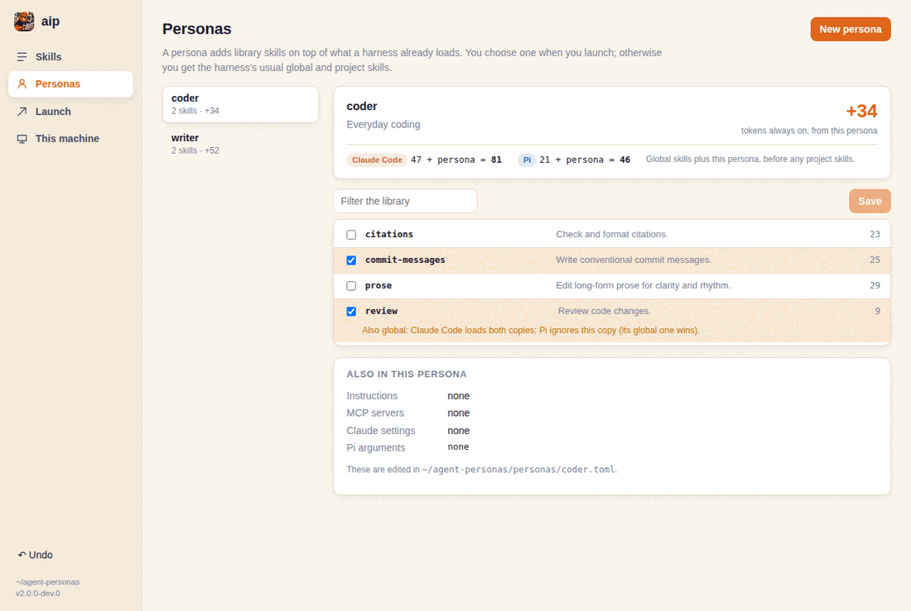
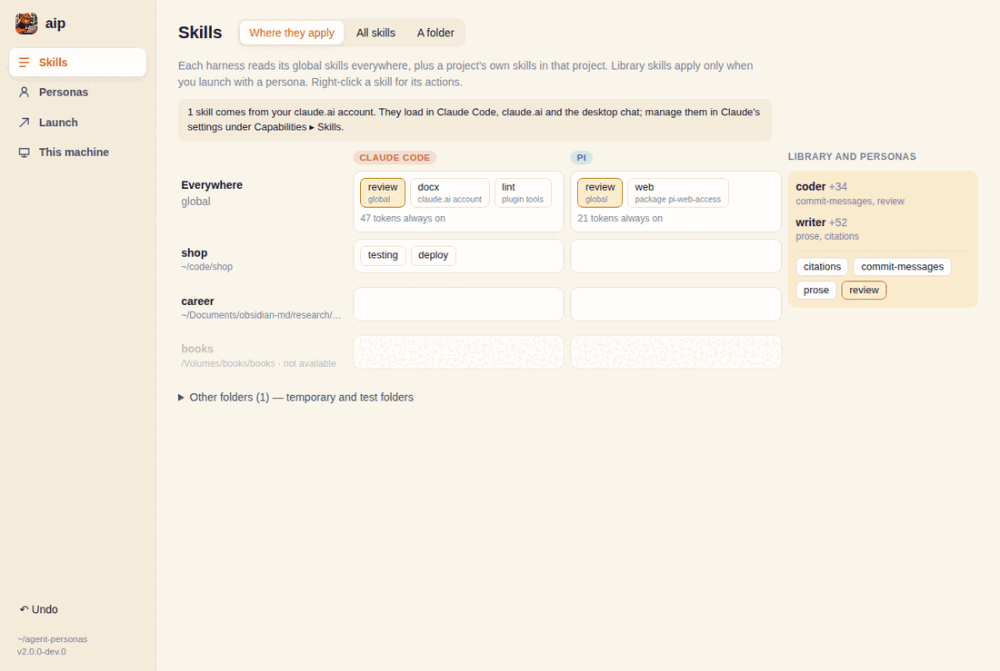
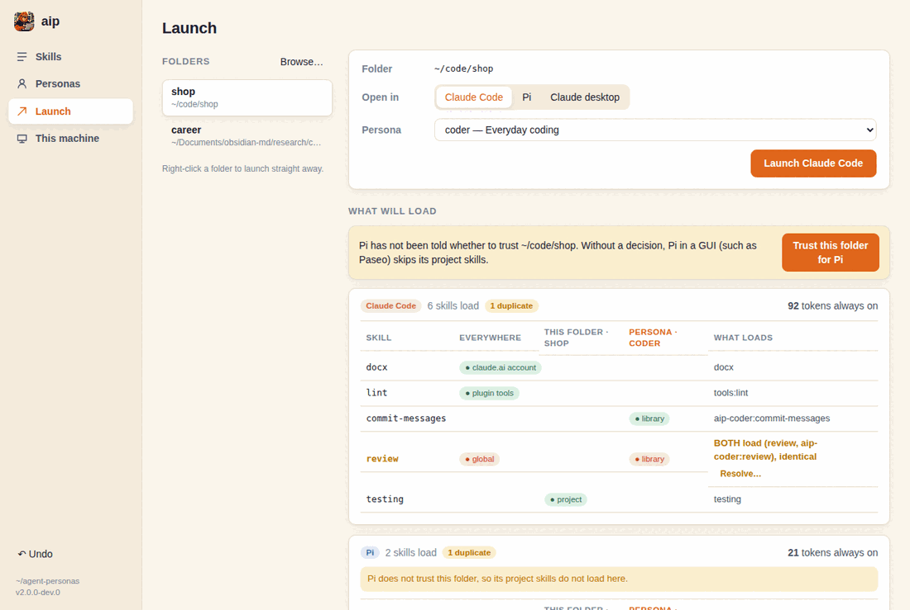

# aip — personas for Claude Code and Pi

[](https://github.com/code-ministry-ltd/aip/actions/workflows/rust.yml)

aip keeps your agent skills in one **library** and lets you choose a
**persona** — a set of library skills — each time you start Claude Code or
Pi. A persona adds its skills on top of what the harness already loads, only
for that session, so your global setup stays small and every project gets
the skills it needs. Personas live in a Git repository that aip syncs across
your machines.

aip is a desktop app for macOS and Linux, plus the `aip` command.



## Install

**macOS** (Apple silicon or Intel, macOS 12 or later): download the `.dmg`
from the [latest release](https://github.com/code-ministry-ltd/aip/releases/latest)
and drag aip to Applications. aip is not signed by Apple yet, so the first
open needs [a few extra steps](docs/install-macos.md).

**Linux:** the AppImage (any distribution), or the `.deb` or `.rpm`, from the
[latest release](https://github.com/code-ministry-ltd/aip/releases/latest).

**The `aip` command:** in the app, open **Settings ▸ Command-line tool** and
choose **Install command-line tool**. On a machine without the app, install
the command alone:

```sh
curl -fsSL https://github.com/code-ministry-ltd/aip/releases/latest/download/install.sh | sh
```

**Updates:** the app checks for a new release when it starts (you can turn
this off in Settings) and installs it when you agree. A command-line install
updates with `aip self-update`; for a `.deb` or `.rpm`, the app tells you
when to download the new package.

Windows is not supported yet; see [aip 0.x](#aip-0x).

## Getting started

When the app first opens, it offers to:

- **start a new personas repository** with a few example skills and
  personas (`aip init` does the same);
- **clone your existing one** from its Git URL, on a second machine
  (`aip clone URL`);
- **bring over aip 0.x profiles**, turning each profile into a persona and
  its skills into library skills, then removing the 0.x shell hook
  (`aip import-v0`).

The repository lives in `~/agent-personas` (set `AIP_ROOT`, or pass
`--root DIR`, to use another folder).

## Skills: where they apply



**Skills** shows every skill on the machine and where it applies:

- **Everywhere:** each harness's global skills (`~/.claude/skills`, your
  claude.ai skills and enabled plugins for Claude Code; `~/.pi/agent/skills`,
  `~/.agents/skills` and packages for Pi).
- **In a project:** the folder's own skills (`.claude/skills`,
  `.agents/skills`, `.pi/skills`).
- **With a persona:** library skills, only when you launch with that
  persona.

Skills that exist in more than one place are flagged. Compare the copies,
copy one into the library, or move the others to the Trash; every change is
previewed first and can be undone. **A folder** shows exactly what each
harness will load there, with or without a persona, and how many tokens the
skills cost before you type anything.

## Personas

**Personas** lists your personas; tick library skills to add or remove them,
and the always-on token budget updates as you go. Each persona is a file in
`personas/`:

```toml
format = 1
description = "Long-form writing"
skills = ["prose", "citations"]   # library skill names
instructions = "writer.md"        # optional: appended to the system prompt

[mcp_servers.fetch]               # optional: added to your MCP servers
command = "uvx"
args = ["mcp-server-fetch"]

[claude.settings]                 # optional: Claude Code settings
model = "opus"

[pi]                              # optional: extra arguments for pi
args = ["--thinking", "high"]
```

Library skills live in `library/skills/<name>/SKILL.md`. Claude Code shows a
persona's skills as `aip-<persona>:<skill>`; Pi shows their plain names.

## Launching



**Launch** takes a folder, a harness and a persona, shows what will load,
and opens the harness in your terminal. Save a combination as a favourite
for one click next time.

From a file manager (turn the menu on in Settings), right-click a folder:
Finder's **Open with aip…** opens a small keyboard picker for the harness
and persona, and Dolphin, Nautilus and Nemo get an **aip** menu listing each
persona and harness directly.

From a terminal:

```sh
aip launch writer claude            # in this folder
aip launch coder pi --dir ~/code/shop --terminal
aip launch --favourite shop
```

## Sync

The personas repository is plain Git. Set its remote in **Settings ▸ Sync**
(or `git -C ~/agent-personas remote add origin URL`), and aip:

- syncs when the app opens, so other machines' changes arrive before you
  edit anything here;
- syncs on changes: two minutes after the repository stops changing, while
  the app is open, whatever made the change (the app, the CLI, an agent
  editing a skill, a hand edit);
- shows **Sync now** whenever this machine has changes the others have not
  received.

Both automatic syncs can be turned off in Settings. When two machines
changed the same file, aip changes nothing and shows both versions side by
side for you to choose; `aip sync --take PATH=ours|theirs` does the same from
a terminal.

## The aip skill

aip keeps an `aip` skill in your library. Add it to a persona, and agents
launched with that persona can manage aip for you: build personas, bring
skills into the library, install skills from Git, tidy duplicates and sort
out sync conflicts, always showing you the change before making it. aip
updates the skill when aip updates, unless you have edited it.

## The `aip` command

| Command | |
|---|---|
| `aip list` | Library skills and personas, with their token cost |
| `aip show PERSONA` | What a persona loads in a folder, per harness |
| `aip skills ls` | Every skill on the machine (`--duplicates`, `--folder DIR`, `--json`) |
| `aip skills cp` / `rm` / `diff` | Copy a skill into the library, move a copy to the Trash, compare two copies |
| `aip skills add SOURCE` | Install a skill into the library from Git (`owner/repo/path` or a Git URL) |
| `aip skills update` / `remove` | Update or remove skills installed from Git |
| `aip skills history` / `undo` | Recent changes, and undo the latest |
| `aip persona add` / `remove` / `delete` | Change a persona's skills, or delete it |
| `aip launch PERSONA HARNESS` | Start Claude Code or Pi with a persona |
| `aip verify PERSONA HARNESS` | Ask the harness what it loaded and check it against the preview |
| `aip favourites` | Saved launches |
| `aip sync` | Commit, pull and push the personas repository |
| `aip init` / `clone URL` / `import-v0` | Start a repository, clone one, or bring over aip 0.x |
| `aip integrations` | File-manager menus |
| `aip self-update` | Update a command-line install |

Commands that change something print what they will do and stop; run them
again with `--yes` to apply. `aip COMMAND --help` has the details.

## aip 0.x

aip 0.x gave each harness a whole profile folder, swapped in by a shell
hook. aip 2 replaces that with personas over one library, added on top of
each harness's normal setup, so they also work from GUI apps. aip 2 supports
Claude Code and Pi on macOS and Linux; 0.x also covered Codex, OpenCode and
Windows.

**Switching:** install aip 2 and open it. The first-run screen finds your
0.x profiles and turns each into a persona, its skills into library skills
and its instructions into the persona's, then removes the 0.x shell hook.
If your profiles repository has a remote, the converted personas are pushed
to it, and your other machines pick them up when you open aip 2 there. From
a terminal, `aip import-v0` does the same. Harness settings and Codex or
OpenCode configuration are listed, not carried over.

**Staying on 0.x** (on Windows, or for Codex or OpenCode): the last 0.x
release, 0.9.5, is on npm. To install it:

```sh
npx -y @code-ministry/aip@0 install
```

`aip update` keeps a 0.x install on 0.x. The 0.x documentation is in the
[0.9.5 README](https://github.com/code-ministry-ltd/aip/tree/v0.9.5#readme).

## Development

```sh
npm --prefix ui ci && npm --prefix ui run build
cargo test --workspace
cargo run -p aip-app --features custom-protocol   # the app
cargo run -p aip-cli -- list                       # the command
```

On Linux the app needs WebKitGTK and a few other libraries:
`sudo apt-get install pkg-config libdbus-1-dev libwebkit2gtk-4.1-dev libxdo-dev libssl-dev librsvg2-dev`.
[docs/design](docs/design/README.md) has screenshots of every screen and
notes on running the UI with hot reload; [ci](ci/README.md) describes the
workflows and releases.
